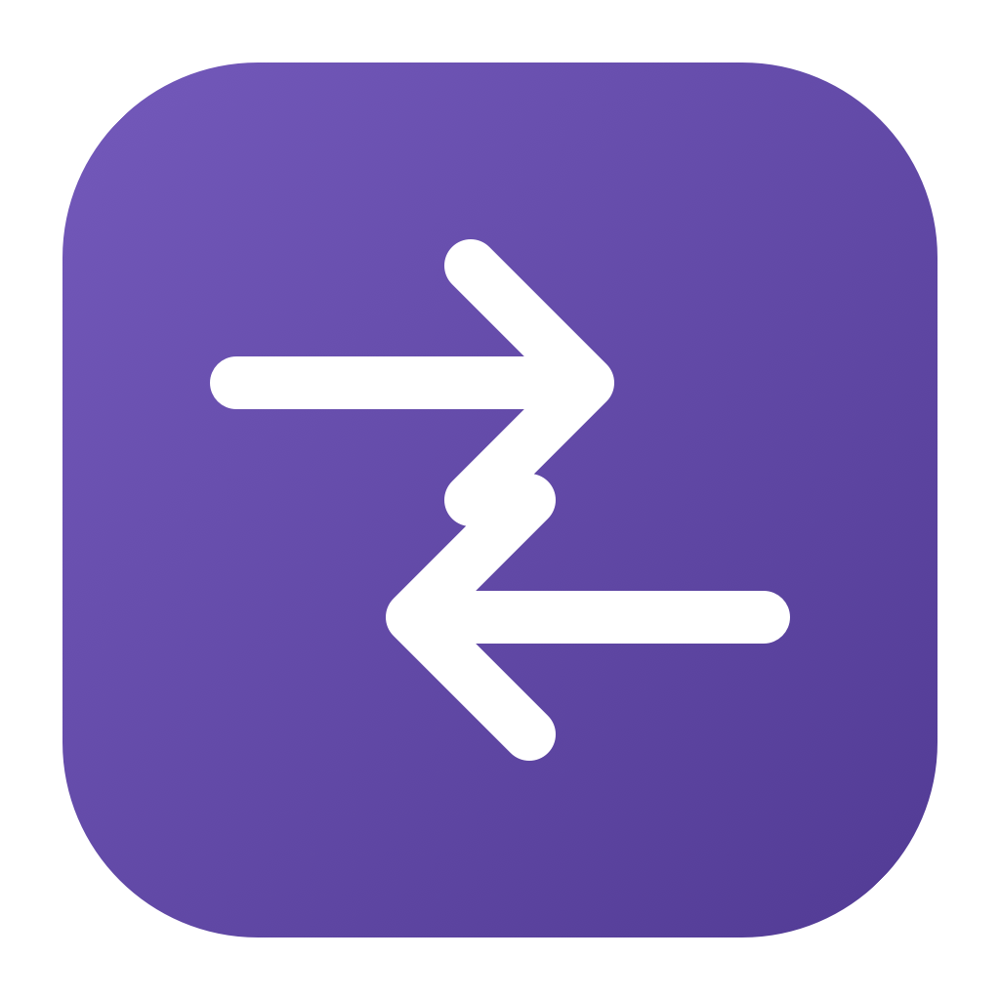
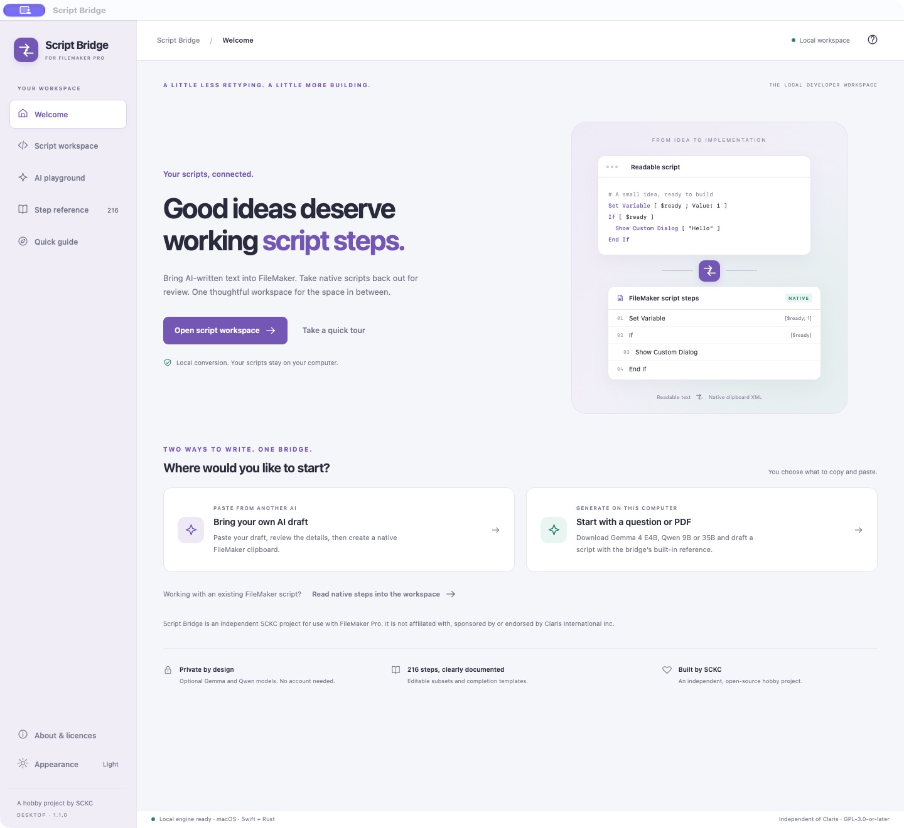
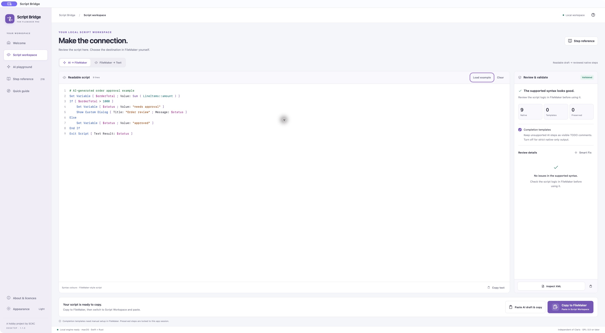
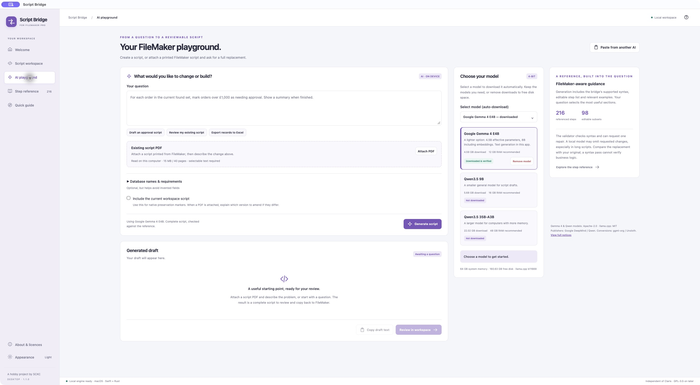

<div align="center">



# Script Bridge

### An independent script workspace for use with FileMaker Pro.

<p>Paste a draft from your favourite AI tool, or write one with on-device Gemma or Qwen.<br>Review the result. Copy native steps. Keep building in FileMaker.</p>

**Version 1.1.0 · PDF amendments, script colours and a lighter local model**

<sub>Independent software by SCKC. Not affiliated with, sponsored by or endorsed by Claris International Inc.</sub>

<p><a href="https://github.com/samuelkcc/script-bridge/releases/download/v1.1.0/Script-Bridge-macOS.zip"></a>&nbsp;<a href="https://github.com/samuelkcc/script-bridge/releases/download/v1.1.0/Script-Bridge-Windows-x64.exe"></a></p>

[Release notes](https://github.com/samuelkcc/script-bridge/releases/tag/v1.1.0) · [Quick start](#your-first-script) · [Supported syntax](Documentation/SUPPORTED_SYNTAX.md) · [Licence](LICENSE)

</div>



<p align="center"><sub>The running macOS app, shown in full. Mac and Windows share the same interface; native window controls differ.</sub></p>

## A useful script should not mean retyping every step

AI tools produce readable text. FileMaker Pro Script Workspace expects a private native clipboard format. Script Bridge connects the two: it validates readable script text and turns supported syntax into native steps you can paste into FileMaker. It also turns copied FileMaker steps back into readable text for review and editing.

You choose the script, destination and insertion point. The app prepares clipboard data; FileMaker remains where you review and run your work.

## New in 1.1.0

Script Bridge keeps the shared Mac and Windows workspace introduced in 1.0.0 and adds a workflow for amending scripts printed from FileMaker Pro.

- **Script colours restored.** Steps, variables, calculations, strings and comments are readable in light and dark appearance.
- **Attach an existing script PDF.** Preview its extracted text, describe your change, and ask for a full replacement draft. Replace or remove attachments at any time while idle.
- **A lighter model option.** Google Gemma 4 E4B joins Qwen 9B and 35B, with automatic downloads and model removal.
- **Review before copying.** The built-in syntax guide supports generation; validation and Smart Fix help review the result before you create native clipboard data.
- **An independent identity.** Script Bridge is developed by SCKC, with clear compatibility wording, non-affiliation notices and offline component licences.

## Download

| Platform | Package | Status and requirements |
| --- | --- | --- |
| **macOS** | [Download the app ZIP](https://github.com/samuelkcc/script-bridge/releases/download/v1.1.0/Script-Bridge-macOS.zip) | Apple Silicon · macOS 13.3 or later · daily use and extensive hands-on testing |
| **Windows** | [Download the x64 installer](https://github.com/samuelkcc/script-bridge/releases/download/v1.1.0/Script-Bridge-Windows-x64.exe) | Windows 10/11 x64 · available for native Windows testing |

### Developed on macOS, shared with Windows users

I develop and use Script Bridge on macOS in my daily FileMaker work. The Mac version receives extensive hands-on debugging and testing, with improvements driven by the issues and small frustrations I find along the way.

I created the Windows edition to share the same vision: making life easier for other FileMaker users and developers facing the same script-handover problem. It shares the Mac interface, but it has not yet received the same hands-on testing. Native Windows validation is still pending, so some behaviour may need fixes.

If something does not work as expected, please [report it here on GitHub](https://github.com/samuelkcc/script-bridge/issues/new). Include your Windows and FileMaker Pro versions, what you expected, what happened and the steps to reproduce it. A screenshot or sample script with private information removed is helpful. I can use my Windows machine to reproduce and validate your case.

— Samuel / SCKC

**Mac:** Extract the ZIP and move **Script Bridge.app** to Applications. The app is ad-hoc signed and is not Apple-notarized. Your macOS security settings may require an additional first-open confirmation.

**Windows:** Run the installer, then open the app from Start. The installer includes the conversion worker and required DLLs; Swift does not need to be installed. Setup obtains Microsoft WebView2 from Microsoft if it is missing, which requires internet access. The installer is unsigned. Installation, display, FileMaker copy/paste and AI inference still need native Windows acceptance testing. [Windows test guide →](Documentation/WINDOWS_BUILD.md#windows-acceptance)

The 1.1.0 Mac package is **Apple Silicon**. Intel Mac users can access the [previous universal SwiftUI release](https://github.com/samuelkcc/script-bridge/releases/tag/v2026.09.29), which has the older interface and no built-in AI playground.

FileMaker Pro 26 is the documented clipboard target and needs a separate valid licence and Claris-supported operating system. Model weights are optional downloads and are not included in either package. Matching source archives, original component sources and checksums are attached to the [1.1.0 release](https://github.com/samuelkcc/script-bridge/releases/tag/v1.1.0).

## Your first script

### Bring a draft from another AI tool

1. Copy readable FileMaker-style script text from your AI tool or editor.
2. Open **Script workspace → AI → FileMaker** and choose **Paste AI draft & copy**. If you type or edit directly, choose **Copy to FileMaker** after validation.
3. Review the validation details and use **Smart Fix** for flagged syntax or missing options.
4. In FileMaker Pro Script Workspace, select an insertion point and paste with **⌘V** on Mac or **Ctrl+V** on Windows. Review and test the result in your solution.



*Readable text on the left. Validation and review on the right. Native clipboard actions stay within reach at the bottom.*

### Start with on-device Gemma or Qwen

1. Open **AI playground** and use **Select model (auto-download)** to choose Gemma 4 E4B, Qwen 9B or 35B.
2. When the model is ready, describe the script you need. Add your actual table, field and layout names in the optional database context.
3. Generate a draft. The bridge supplies relevant reference material, checks the supported syntax and can request one repair using its diagnostics.
4. Choose **Review in workspace**, check the result, then copy native steps into FileMaker.



*The playground uses the same review and clipboard workflow as a draft pasted from another AI tool.*

| Optional model | Download size | Suggested system memory |
| --- | --- | --- |
| **Google Gemma 4 E4B** · Q4_0 | 4.59 GB | 12 GB or more |
| **Qwen3.5 9B** · Q4_K_M | 5.68 GB | 16 GB or more |
| **Qwen3.5 35B-A3B** · Q4_K_M | 22.02 GB | 48 GB or more |

Memory figures are estimates with headroom. Actual use depends on context length and other applications. macOS inference uses Metal; the Windows package currently uses the portable CPU runtime, so generation speed differs.

Model downloads are pinned to exact ggml-org (Gemma) and Unsloth (Qwen) GGUF conversions, verified by size and SHA-256, and stored outside the application. Select an interrupted model download to resume it. **Remove model** unloads and deletes an installed model; **Remove download** discards a partial download. Selecting it again downloads a fresh copy. The [model catalogue](Desktop/ai/catalogue.json) records versions, sources, sizes and licence details.

The built-in reference guides syntax; it does not inspect your database or establish that a script's logic is correct. Review generated fields, paths, calculations and business rules before running them.

### Amend a printed script PDF

1. Print the existing script from FileMaker Pro Script Workspace to a PDF with selectable text.
2. In **AI playground**, choose **Attach PDF**, check **Preview extracted text**, and describe the problem and required change.
3. Generate a **full replacement draft**, including unchanged sections. Choose **Review in workspace**, compare it with the original, and resolve every blocking issue before copying to FileMaker.
4. Use **Replace PDF** for a newer printout or **Remove PDF** to discard the attachment.

PDFs are read locally (up to 15 MB, 40 pages and 120,000 extracted characters). The local model's context can impose a smaller limit; oversized requests are rejected without shortening the source. Scans need OCR first. A printout cannot retain hidden native step options. Full replacements can still omit requirements or need manual correction; test in a copy of your solution.

### Review an existing FileMaker script

Copy selected native steps in FileMaker, or copy a whole script from the Scripts pane. In the bridge, choose **FileMaker → Text**, then **Read FileMaker clipboard**. The resulting readable text is ready for your editor or AI tool. Native Windows clipboard transport differs from macOS and is part of the Windows acceptance checklist.

## Clear support boundaries

The app's reference covers **216 official script steps**, with **98 editable subsets** and completion templates for the remaining **118**. Editable support can be limited to specific verified option profiles; a recognised step name does not mean every option is reconstructable.

| Result | What it means |
| --- | --- |
| **Native editable subset** | The documented text form can be rebuilt into native FileMaker clipboard XML. |
| **Completion template** | An unsupported AI-authored step becomes a visible TODO comment for manual setup. It does not execute the requested action. Strict native-only mode blocks these drafts instead. |
| **Preserved native step** | A step copied from FileMaker can retain its original XML behind an unchanged preservation marker during the same app session. |

Preservation markers depend on in-memory originals. Closing the app discards those originals; copy the source steps from FileMaker again before continuing in a new session. Unrecognised or ambiguous syntax is flagged instead of silently dropped.

See the [supported syntax](Documentation/SUPPORTED_SYNTAX.md), [coverage index](Documentation/CLARIS_SCRIPT_STEP_COVERAGE.md) and [AI review workflow](Documentation/AI_REVIEW_WORKFLOW.md) for details. Private FileMaker clipboard structures can change between versions.

## Your scripts stay on your computer

Conversion, validation and optional Gemma / Qwen inference run on this computer. There are no accounts or analytics. The app does not upload prompts or scripts to a hosted AI service. Optional model downloads require a network connection; opening external links or installing a missing WebView2 runtime also uses the network.

Questions, attached PDF text, generated drafts and preserved native steps stay in memory. Downloaded models and verification receipts persist in the app's per-user data folder. You choose whether to include the current workspace script as generation context. Content you copy into an external AI tool is handled by that tool's own terms.

## Built with care, open to inspection

The shared interface uses HTML, CSS and JavaScript inside a **Tauri 2 / Rust** desktop host. The tested **Swift** engine runs as a persistent local worker. **llama.cpp** supplies optional native inference. The architecture keeps platform clipboard code separate while sharing the workflow and UI.

Automated verification includes 107 Swift tests, 9 JavaScript/worker tests and 12 Rust host, knowledge and codec tests. Separate integration checks cover download resume and checksum rejection, plus real Gemma 4 E4B and Qwen 9B short-script generation through the Swift validator. Gemma 4 E4B also produced a complete replacement for the private seven-page PDF fixture with the requested threshold branches and zero syntax errors. Long PDF amendments remain drafts: Qwen 9B exposed omitted requirements and syntax errors, which blocked native copying. Neither check establishes correct business logic in a live database. The 35B model has not been inference-tested. Native Windows acceptance is pending.

[Architecture and platform status](Documentation/DESKTOP_ARCHITECTURE.md) · [Windows build instructions](Documentation/WINDOWS_BUILD.md) · [Release history](RELEASE_NOTES.md)

<details>
<summary><strong>Build and test locally</strong></summary>

The shared desktop build requires Rust, Python 3.12 or later and Swift 6. macOS also needs Xcode Command Line Tools. Fetch the locked dependencies and pinned inference runtime before an offline build.

```sh
cargo fetch --locked --manifest-path Desktop/src-tauri/Cargo.toml
python3 Scripts/prepare-ai-runtime.py --fetch
python3 Scripts/desktop.py build
node --test Desktop/tests/*.test.mjs
cargo test --locked --offline --manifest-path Desktop/src-tauri/Cargo.toml
python3 Scripts/prepare-pdf-sources.py --download
python3 Scripts/desktop.py package
```

Run the Swift suite with an Xcode installation that provides XCTest:

```sh
swift test --disable-sandbox --scratch-path .build/desktop-tests
```

Current launchable deliverables are kept in `dist/`. Archives, component sources, staging and release records live in `.build/releases/1.1.0/`. The older `Scripts/package-app.sh` builds the previous SwiftUI edition. Use the [Windows guide](Documentation/WINDOWS_BUILD.md) for the matching cross-build toolchain and installer recipe.

</details>

## Licence and acknowledgements

Created by **SCKC** as an independent, open-source hobby project. Script Bridge is released under [GPL-3.0-or-later](LICENSE), without warranty. Gemma 4 and Qwen models retain Apache-2.0; llama.cpp retains MIT. PDF.js, compatibility libraries, fonts and CMaps retain their original licences. Other components retain their own terms. Full original notices are available offline under **About & licences** and in the corresponding source archives.

Script Bridge is independently developed by SCKC. It is not made by, authorized, sponsored, endorsed by, supported by or affiliated with Claris International Inc. FileMaker and FileMaker Pro are trademarks of Claris International Inc.

[Promotion and licensing review](Documentation/PROMOTION_AND_LICENSING.md) · [Report an issue](https://github.com/samuelkcc/script-bridge/issues)

## Support the project

Script Bridge is an independent hobby project by SCKC. If it saves you time, you can help support its ongoing development by buying Samuel a coffee.

<a href="https://buymeacoffee.com/samuelchen"></a>
