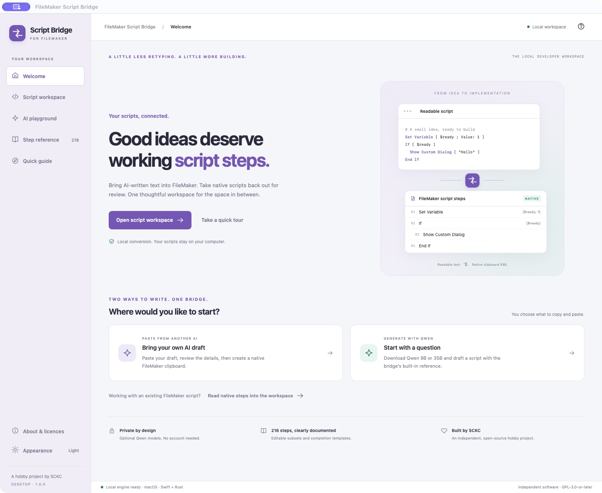
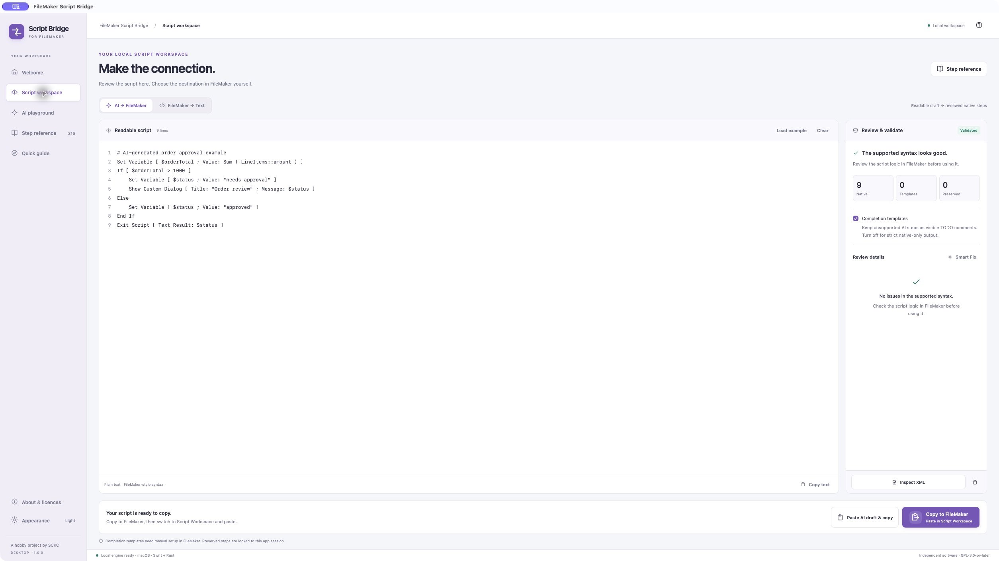
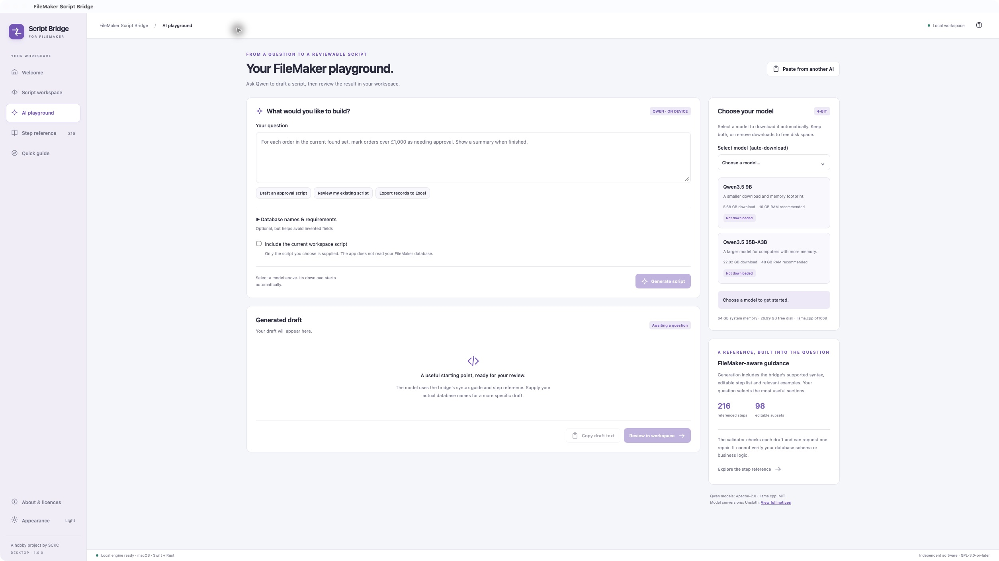

<div align="center">


# FileMaker Script Bridge

### From an AI idea to working FileMaker steps.

<p>Paste a draft from your favourite AI tool, or write one with on-device Qwen.<br>Review the result. Copy native steps. Keep building in FileMaker.</p>

**Version 1.0.0 · The redesigned desktop edition**

<p><a href="https://github.com/samuelkcc/filemaker-script-bridge/releases/download/v1.0.0/FileMaker-Script-Bridge-macOS.zip"></a>&nbsp;<a href="https://github.com/samuelkcc/filemaker-script-bridge/releases/download/v1.0.0/FileMaker-Script-Bridge-Windows-x64.exe"></a></p>

[Release notes](https://github.com/samuelkcc/filemaker-script-bridge/releases/tag/v1.0.0) · [Quick start](#your-first-script) · [Supported syntax](Documentation/SUPPORTED_SYNTAX.md) · [Licence](LICENSE)

</div>



<p align="center"><sub>The running macOS app, shown in full. Mac and Windows share the same interface; native window controls differ.</sub></p>

## A useful script should not mean retyping every step

AI tools produce readable text. FileMaker Pro Script Workspace expects a private native clipboard format. FileMaker Script Bridge connects the two: it validates readable script text and turns supported syntax into native steps you can paste into FileMaker. It also turns copied FileMaker steps back into readable text for review and editing.

You choose the script, destination and insertion point. The app prepares clipboard data; FileMaker remains where you review and run your work.

## A major update for 1.0.0

Version 1.0.0 replaces the previous SwiftUI interface with an AniCanto-inspired desktop workspace shared by macOS and Windows. The existing Swift conversion engine sits behind a new Tauri/Rust host.

- **A fresh workspace.** Clear navigation, a script editor, live validation, Smart Fix review and a prominent Copy to FileMaker action.
- **Two ways to write.** Bring a draft from another AI tool, or generate one in the built-in Qwen playground.
- **Optional local models.** Select Qwen 9B or 35B to download automatically. Resume an interrupted download or remove a model to recover disk space.
- **Reference-grounded generation.** The playground uses the bridge's syntax guide and supported-step catalogue, then validates the draft before you review it.
- **Light, dark and system appearance.** One design across platforms, with an updated purple bridge icon.
- **Licences included.** A redesigned About screen and searchable offline application, component, model and inference-engine notices.

## Download

| Platform | Package | Status and requirements |
| --- | --- | --- |
| **macOS** | [Download the app ZIP](https://github.com/samuelkcc/filemaker-script-bridge/releases/download/v1.0.0/FileMaker-Script-Bridge-macOS.zip) | Apple Silicon · macOS 13 or later · built and checked on macOS |
| **Windows** | [Download the x64 installer](https://github.com/samuelkcc/filemaker-script-bridge/releases/download/v1.0.0/FileMaker-Script-Bridge-Windows-x64.exe) | Windows 10/11 x64 · available for native Windows testing |

**Mac:** Extract the ZIP and move **FileMaker Script Bridge.app** to Applications. The app is ad-hoc signed and is not Apple-notarized. Your macOS security settings may require an additional first-open confirmation.

**Windows:** Run the installer, then open the app from Start. The installer includes the conversion worker and required DLLs; Swift does not need to be installed. Setup obtains Microsoft WebView2 from Microsoft if it is missing, which requires internet access. The installer is unsigned. Installation, display, FileMaker copy/paste and AI inference still need native Windows acceptance testing. [Windows test guide →](Documentation/WINDOWS_BUILD.md#windows-acceptance)

The 1.0.0 Mac package is **Apple Silicon**. Intel Mac users can access the [previous universal SwiftUI release](https://github.com/samuelkcc/filemaker-script-bridge/releases/tag/v2026.09.29), which has the older interface and no built-in Qwen playground.

FileMaker Pro 26 is the documented clipboard target. Model weights are optional downloads and are not included in either package. Matching source archives, original component sources and checksums are attached to the [1.0.0 release](https://github.com/samuelkcc/filemaker-script-bridge/releases/tag/v1.0.0).

## Your first script

### Bring a draft from another AI tool

1. Copy readable FileMaker-style script text from your AI tool or editor.
2. Open **Script workspace → AI → FileMaker** and choose **Paste AI draft & copy**. If you type or edit directly, choose **Copy to FileMaker** after validation.
3. Review the validation details and use **Smart Fix** for flagged syntax or missing options.
4. In FileMaker Pro Script Workspace, select an insertion point and paste with **⌘V** on Mac or **Ctrl+V** on Windows. Review and test the result in your solution.



*Readable text on the left. Validation and review on the right. Native clipboard actions stay within reach at the bottom.*

### Start with on-device Qwen

1. Open **AI playground** and use **Select model (auto-download)** to choose Qwen 9B or 35B.
2. When the model is ready, describe the script you need. Add your actual table, field and layout names in the optional database context.
3. Generate a draft. The bridge supplies relevant reference material, checks the supported syntax and can request one repair using its diagnostics.
4. Choose **Review in workspace**, check the result, then copy native steps into FileMaker.



*The playground uses the same review and clipboard workflow as a draft pasted from another AI tool.*

| Optional model | Download size | Suggested system memory |
| --- | --- | --- |
| **Qwen3.5 9B** · Q4_K_M | 5.68 GB | 16 GB or more |
| **Qwen3.5 35B-A3B** · Q4_K_M | 22.02 GB | 48 GB or more |

Memory figures are estimates with headroom. Actual use depends on context length and other applications. macOS inference uses Metal; the Windows package currently uses the portable CPU runtime, so generation speed differs.

Model downloads are pinned to exact Unsloth GGUF conversions, verified by size and SHA-256, and stored outside the application. Select an interrupted model download to resume it. **Remove model** unloads and deletes an installed model; **Remove download** discards a partial download. Selecting it again downloads a fresh copy. The [model catalogue](Desktop/ai/catalogue.json) records versions, sources, sizes and licence details.

The built-in reference guides syntax; it does not inspect your database or establish that a script's logic is correct. Review generated fields, paths, calculations and business rules before running them.

### Review an existing FileMaker script

Copy selected native steps in FileMaker, or copy a whole script from the Scripts pane. In the bridge, choose **FileMaker → Text**, then **Read FileMaker clipboard**. The resulting readable text is ready for your editor or AI tool. Native Windows clipboard transport differs from macOS and is part of the Windows acceptance checklist.

## Clear support boundaries

The app's reference covers **216 official script steps**, with **98 editable subsets** and completion templates for the remaining **118**. Editable support can be limited to specific verified option profiles; a recognised step name does not mean every option is reconstructable.

| Result | What it means |
| --- | --- |
| **Native editable subset** | The documented text form can be rebuilt into native FileMaker clipboard XML. |
| **Completion template** | An unsupported AI-authored step becomes a visible TODO comment for manual setup. It does not execute the requested action. Strict native-only mode blocks these drafts instead. |
| **Preserved native step** | A step copied from FileMaker can retain its original XML behind an unchanged preservation marker during the same app session. |

Preservation markers depend on in-memory originals. Closing the app discards those originals; copy the source steps from FileMaker again before continuing in a new session. Unrecognised or ambiguous syntax is flagged instead of silently dropped.

See the [supported syntax](Documentation/SUPPORTED_SYNTAX.md), [coverage index](Documentation/CLARIS_SCRIPT_STEP_COVERAGE.md) and [AI review workflow](Documentation/AI_REVIEW_WORKFLOW.md) for details. Private FileMaker clipboard structures can change between versions.

## Your scripts stay on your computer

Conversion, validation and optional Qwen inference run on this computer. There are no accounts or analytics. The app does not upload prompts or scripts to a hosted AI service. Optional model downloads require a network connection; opening external links or installing a missing WebView2 runtime also uses the network.

Questions, generated drafts and preserved native steps stay in memory. Downloaded models and verification receipts persist in the app's per-user data folder. You choose whether to include the current workspace script as generation context. Content you copy into an external AI tool is handled by that tool's own terms.

## Built with care, open to inspection

The shared interface uses HTML, CSS and JavaScript inside a **Tauri 2 / Rust** desktop host. The tested **Swift** engine runs as a persistent local worker. **llama.cpp** supplies optional native inference. The architecture keeps platform clipboard code separate while sharing the workflow and UI.

Automated verification includes 107 Swift tests, 5 JavaScript/worker tests and 10 Rust host, knowledge and codec tests. Separate integration checks cover download resume and checksum rejection, plus real Qwen 9B generation through the Swift validator. The 35B model has not been inference-tested. Native Windows acceptance is pending.

[Architecture and platform status](Documentation/DESKTOP_ARCHITECTURE.md) · [Windows build instructions](Documentation/WINDOWS_BUILD.md) · [Release history](RELEASE_NOTES.md)

<details>
<summary><strong>Build and test locally</strong></summary>

The shared desktop build requires Rust, Python 3.12 or later and Swift 6. macOS also needs Xcode Command Line Tools. Fetch the locked dependencies and pinned inference runtime before an offline build.

```sh
cargo fetch --locked --manifest-path Desktop/src-tauri/Cargo.toml
python3 Scripts/prepare-ai-runtime.py --fetch
python3 Scripts/desktop.py build
node --test Desktop/tests/*.test.mjs
cargo test --locked --offline --manifest-path Desktop/src-tauri/Cargo.toml
python3 Scripts/desktop.py package
```

Run the Swift suite with an Xcode installation that provides XCTest:

```sh
swift test --disable-sandbox --scratch-path .build/desktop-tests
```

Current launchable deliverables are kept in `dist/`. Archives, component sources, staging and release records live in `.build/releases/1.0.0/`. The older `Scripts/package-app.sh` builds the previous SwiftUI edition. Use the [Windows guide](Documentation/WINDOWS_BUILD.md) for the matching cross-build toolchain and installer recipe.

</details>

## Licence and acknowledgements

Created by **SCKC** as an independent, open-source hobby project. FileMaker Script Bridge is released under [GPL-3.0-or-later](LICENSE), without warranty. Qwen models retain Apache-2.0; llama.cpp retains MIT. Other components retain their own terms. Full original notices are available offline under **About & licences** and in the corresponding source archives.

This project is not made by, affiliated with, endorsed by or supported by Claris International Inc. FileMaker and FileMaker Pro are trademarks of Claris International Inc.

[Report an issue](https://github.com/samuelkcc/filemaker-script-bridge/issues) · [Support Samuel's hobby projects](https://www.buymeacoffee.com/samuelchen)
